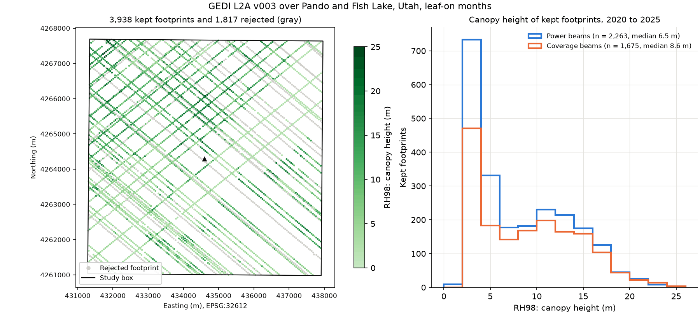

# Canopy height from GEDI lidar footprints

| | |
| --- | --- |
| **Notebook** | [`gedi-canopy-height-python.ipynb`](gedi-canopy-height-python.ipynb) (an R version is planned) |
| **Question** | How tall is the forest around the Pando aspen stand, according to GEDI's laser footprints, and which footprints can we trust? |
| **You will** | Find GEDI granules in NASA's catalog; submit an asynchronous NASA Harmony request that returns only the study area and the needed variables; read HDF5 files with h5py; screen footprints with the version 3 quality and degrade flags; map RH98 canopy height as samples and compare power and coverage beams |
| **Prerequisites** | [Getting started](../getting-started/); an Earthdata Login in `~/.netrc`. The Python environment must include `h5py` and `harmony-py` (added on 2026-11-04; see below). |
| **Data** | GEDI L2A v003 (`GEDI02_A`); 19 leaf-on granules (about 34 GB in full) reduced by Harmony to about 5 MB |
| **Time** | About 25 minutes of learner time, plus Harmony processing (1 to 10 minutes in our runs) |
| **Outputs** | `outputs/gedi-canopy-height/python/`: footprints with quality fields (GeoPackage), figure (PNG), summary and screening table (CSV), provenance with the Harmony job (JSON) |
| **Level** | Intermediate |

This lesson introduces lidar footprints and the brief's asynchronous subsetting pattern. GEDI granules are about 2 GB each, while the footprints over a 6.6 km study box amount to a few hundred kilobytes, so the lesson asks NASA's Harmony service to subset the data where it is stored. It saves the Harmony job number, so a rerun picks up the same job instead of submitting a duplicate, and it stops waiting after `HARMONY_WAIT_MINUTES` (20 by default) with a message to rerun later.

**Environments created before 2026-11-04** lack `h5py` and `harmony-py`. From the repository folder, run `mamba env update -p <prefix>/tfs-python -f environments/python-base.yml` (on CHPC, after `module load miniforge3`), or recreate the environment as described in the [environment guide](../../docs/getting-started/environments.md).

## Products and references

| Product | Version | Access route | Documentation |
| --- | --- | --- | --- |
| GEDI L2A Elevation and Height Metrics, footprint level | v003 (`GEDI02_A`, collection `C3974616071-LPCLOUD`) | `earthaccess` search; NASA Harmony trajectory subsetter (spatial and variable subset) through `harmony-py`; `h5py` | [doi:10.5067/GEDI/GEDI02_A.003](https://doi.org/10.5067/GEDI/GEDI02_A.003); [user guide v3](https://lpdaac.usgs.gov/documents/2442/GEDI02_User_Guide_V3.pdf) |

**Why version 3.** Version 2 is complete and ends in July 2025; version 3 is the active version, with improved geolocation and consistent quality flags. In version 3 the beam groups hold `l2a_quality_flag_rel3` (and the version 2 flag as `l2a_quality_flag_rel2`), not a variable named `quality_flag`. The lesson keeps footprints with `l2a_quality_flag_rel3 == 1` and `degrade_flag == 0`, and offers the user guide's power-beam and night-only recommendations as settings.

With the default settings, the search finds 57 granules over the box (2019 to 2026), of which 19 fall in the leaf-on months (June to September). Harmony returns footprints for 13 of them; the other 6 cross the catalog's rough outline of the box without any footprint inside it, and the job reports them as warnings.

## Support status

| Language | Local (Linux/WSL) | CHPC OnDemand, compute node | CHPC transfer job | Colab |
| --- | --- | --- | --- | --- |
| Python | tested 2026-11-04 | tested 2026-11-04 | untested (optional) | tested 2026-11-04 |
| R | planned | planned | planned | planned |

## Validation record

| Date | Platform | Language | Run | Result | Runtime | Peak kernel memory | New data cached | Footprints kept |
| --- | --- | --- | --- | --- | --- | --- | --- | --- |
| 2026-11-04 | Local (WSL, Ubuntu 22.04) | Python 3.12.16 | Cold (empty cache): new Harmony job | Passed | 342 s | 268 MB | 4.88 MB | 3,938 of 5,755 |
| 2026-11-04 | Local (WSL, Ubuntu 22.04) | Python 3.12.16 | Warm (cache) | Passed | 8 s | 263 MB | 0.00 MB | 3,938 of 5,755 |
| 2026-11-04 | Local (WSL, Ubuntu 22.04) | Python 3.12.16 | Offline (`TFS_OFFLINE=1`) | Passed | 8 s | 264 MB | 0.00 MB | 3,938 of 5,755 |
| 2026-11-04 | CHPC OnDemand, compute node (`notchpeak-shared-short`) | Python 3.12.16 | Cold (empty cache): new Harmony job | Passed | 266 s | 244 MB | 4.88 MB | 3,938 of 5,755 |
| 2026-11-04 | Colab (fresh session) | Python 3.13.18 | Cold (empty cache): new Harmony job | Passed | 305 s, excluding package installation | not recorded | 4.86 MB | 3,938 of 5,755 |

**Checks of the result** (2026-11-04, local):

- **Harmony subsets match the original granules.** For the two largest subsets, every footprint of the busiest beam (150 and 149 footprints) was found in the original 2 GB granule, read remotely, with identical shot numbers, positions, RH98, quality flag, and degrade flag.
- **No duplicate jobs.** A run with `HARMONY_WAIT_MINUTES = 0` submitted a job and stopped with a message naming it; the next run printed "Reusing Harmony job" for the same job, waited for it to finish, and produced the same result.
- **Results.** 5,755 footprints fell inside the box; 3,938 passed the quality and degrade flags (2,263 power, 1,675 coverage). Kept RH98 has a median of 7.44 m and a 90th percentile of 16.05 m.
- **Failure messages.** Offline with an empty cache and a date window before GEDI's record each stop with a message that says what to do.

Runs recorded `c2c331d-dirty`: the notebook and scripts were those of commit c2c331d; the uncommitted changes were to READMEs and the environment guide. The CHPC and Colab runs used commit c9f5406 and gave the same counts and RH98 statistics as the local runs. Harmony processing took 1 to 10 minutes per job across our runs and is the main source of runtime variation.

Full records are in [`validation/`](validation/). Environment: [`python-base.linux-64.lock.txt`](../../environments/python-base.linux-64.lock.txt).
