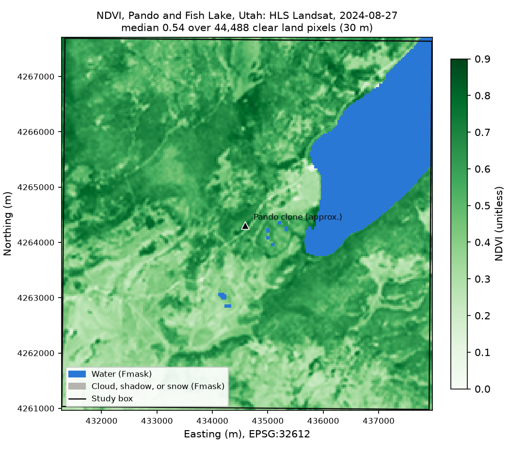

# Mapping vegetation greenness with HLS

| | |
| --- | --- |
| **Notebooks** | [`hls-vegetation-map-python.ipynb`](hls-vegetation-map-python.ipynb) · [`hls-vegetation-map-r.ipynb`](hls-vegetation-map-r.ipynb) |
| **Question** | How green is the forest around the Pando aspen stand in midsummer, and which pixels can we trust? |
| **You will** | Search NASA's catalog for HLS data, rank scenes by how clear the study area is, read only the study-area window of cloud-hosted files, apply scale factors and Fmask quality bits, map NDVI, and save it with provenance |
| **Prerequisites** | [Getting started](../getting-started/); an Earthdata Login in `~/.netrc` |
| **Data** | HLSL30 and HLSS30 v2.0 (NASA LP DAAC); about 0.4 MB of study-area windows from 29 granules |
| **Time** | About 20 minutes of learner time; the first run reads data for about a minute |
| **Outputs** | `outputs/hls-vegetation-map/<language>/`: NDVI Cloud Optimized GeoTIFF, map (PNG), summary and granule ranking (CSV), provenance (JSON) |
| **Level** | Beginner |

The lesson is the project's first complete data lesson. It introduces the pattern later lessons reuse: search a catalog, check what the study area actually contains before downloading, read only what is needed into a cache that also works offline, apply documented scaling and quality rules, and save the result with a record of how it was made. The Python and R versions follow the same steps and produce identical results.

## Products and references

| Product | Version | Access route | Documentation |
| --- | --- | --- | --- |
| HLSL30 (Landsat 8/9) | 2.0 | Python: `earthaccess` search of NASA CMR. R: `rstac` search of NASA CMR-STAC (`LPCLOUD`). Both: GDAL windowed reads over HTTPS with `~/.netrc` | [doi:10.5067/HLS/HLSL30.002](https://doi.org/10.5067/HLS/HLSL30.002) |
| HLSS30 (Sentinel-2A/B/C) | 2.0 | Same | [doi:10.5067/HLS/HLSS30.002](https://doi.org/10.5067/HLS/HLSS30.002) |
| HLS user guide | 2.0 (April 2026) | | [PDF](https://lpdaac.usgs.gov/documents/1698/HLS_User_Guide_V2.pdf) |

The default settings use the `pando` site from [`examples/sites.geojson`](../../examples/sites.geojson) (tile T12SVH) and 15 July to 15 September 2024. With these settings the search returns 16 Landsat and 13 Sentinel-2 granules, and the clearest is `HLS.L30.T12SVH.2024240T180211.v2.0` (27 August 2024), which is 100% clear in the study box. See [upstream-resources.md](../../docs/upstream-resources.md) for how the lesson relates to NASA's HLS tutorials.

## Support status

| Language | Local (Linux/WSL) | CHPC OnDemand, compute node | CHPC transfer job | Colab |
| --- | --- | --- | --- | --- |
| Python | tested 2026-11-03 | tested 2026-11-04 | tested 2026-11-04 | tested 2026-11-04 |
| R | tested 2026-11-03 | tested 2026-11-04 | tested 2026-11-04 | not supported yet |

## Validation record

| Date | Platform | Language | Run | Result | Runtime | Peak kernel memory | New data cached | Files read / cached |
| --- | --- | --- | --- | --- | --- | --- | --- | --- |
| 2026-11-03 | Local (WSL, Ubuntu 22.04) | Python 3.12.16 | Cold (empty cache) | Passed | 60 s | 252 MB | 0.37 MB | 31 / 0 |
| 2026-11-03 | Local (WSL, Ubuntu 22.04) | Python 3.12.16 | Warm (cache) | Passed | 8 s | 248 MB | 0.00 MB | 0 / 31 |
| 2026-11-03 | Local (WSL, Ubuntu 22.04) | Python 3.12.16 | Offline (`TFS_OFFLINE=1`) | Passed | 7 s | 248 MB | 0.00 MB | 0 / 31 |
| 2026-11-03 | Local (WSL, Ubuntu 22.04) | R 4.5.3 | Cold (empty cache) | Passed | 54 s | 320 MB | 0.36 MB | 31 / 0 |
| 2026-11-03 | Local (WSL, Ubuntu 22.04) | R 4.5.3 | Warm (cache) | Passed | 6 s | 323 MB | 0.00 MB | 0 / 31 |
| 2026-11-03 | Local (WSL, Ubuntu 22.04) | R 4.5.3 | Offline (`TFS_OFFLINE=1`) | Passed | 6 s | 315 MB | 0.00 MB | 0 / 31 |
| 2026-11-03 | Local (WSL, Ubuntu 22.04) | R 4.5.3 | Cache from the Python run | Passed | 12 s | 311 MB | 0.02 MB | 0 / 31 |
| 2026-11-04 | CHPC transfer job (`notchpeak-dtn`) | Python 3.12.16 | Cold (empty cache) | Passed | 60 s (job 79 s) | not recorded | not recorded | 31 / 0 |
| 2026-11-04 | Colab (fresh session) | Python 3.13.18 | Cold (empty cache) | Passed | 289 s, excluding package installation | not recorded | not recorded | 31 / 0 |
| 2026-11-04 | CHPC OnDemand, compute node (`notchpeak-shared-short`) | Python 3.12.16 | Run All in Jupyter, from the transfer job's cache | Passed | 76 s | not recorded | 0.00 MB | 0 / 31 |
| 2026-11-04 | CHPC OnDemand, compute node (`notchpeak-shared-short`) | Python 3.12.16 | Cold (empty cache on scratch): searched and downloaded on the compute node | Passed | 76 s | 237 MB | 0.37 MB | 31 / 0 |
| 2026-11-04 | CHPC transfer job (`notchpeak-dtn`) | R 4.5.3 | Cache from the Python runs | Passed | 10 s | 316 MB | 0.00 MB | 0 / 31 |
| 2026-11-04 | CHPC OnDemand, compute node (`notchpeak-shared-short`) | R 4.5.3 | Cache | Passed | 9 s | 319 MB | 0.00 MB | 0 / 31 |

The CHPC and Colab runs selected the same granule and produced the same NDVI statistics as the local runs (median 0.5402, quartiles 0.4000 and 0.6372, 44,488 clear land pixels). Rows marked "not recorded" come from the summary a notebook prints, rather than from `scripts/validate_notebook.py`. The cold OnDemand run shows that the default interactive partition could reach NASA, contrary to CHPC's documentation. Reading the 31 windows took about five times longer from Colab than from CHPC or the University network.

**Checks of the result** (2026-11-03, local):

- **Python and R agree exactly.** Both considered the same 29 granules, selected the same one, and wrote NDVI on the same grid with identical valid-pixel masks (50,168 pixels) and a maximum difference of 0.0. R runs with an independent cache and with the Python cache gave the same result.
- **Known pixels.** For six pixels, NDVI computed by hand from the raw stored values in the full remote files (scaled by the documented 0.0001) matched the lesson's output to within 1.4e-08. Reflectance was checked directly, because NDVI cannot reveal a scaling error: for example, a forest pixel stored red 323 and near-infrared 2847, giving reflectances 0.0323 and 0.2847 and NDVI 0.796.
- **NASA's HLS vegetation-index product.** Over 49,771 clear pixels of the same granule (HLS-VI.L30.T12SVH.2024240T180211.v2.0.NDVI.tif), the lesson's NDVI differs from NASA's by 2.4e-05 on average and at most 5e-05 (the product stores NDVI in steps of 0.0001), with a correlation of 1.000.
- **Windowed reads versus full downloads.** Reading the study-area window of the selected granule's three files took 3.49 s and received about 0.474 MB; downloading the same files in full took 4.04 s and received 53 MB. On this fast university connection the time is similar, but the windowed route transfers about a hundred times less data, which matters on slower networks and when lessons scale up.
- **Failure messages.** Offline with an empty cache, a date window with no granules, a missing `~/.netrc`, and a date with no clear scene each stop with a message that says what to do (tested with the Python notebook).

Runs recorded `c58dc42-dirty`: the notebooks and validation scripts were those of commit c58dc42, while the uncommitted changes were to READMEs and the transfer-job script.

Full records are in [`validation/`](validation/). Environments: [`python-base.linux-64.lock.txt`](../../environments/python-base.linux-64.lock.txt) and [`r-base.linux-64.lock.txt`](../../environments/r-base.linux-64.lock.txt).
