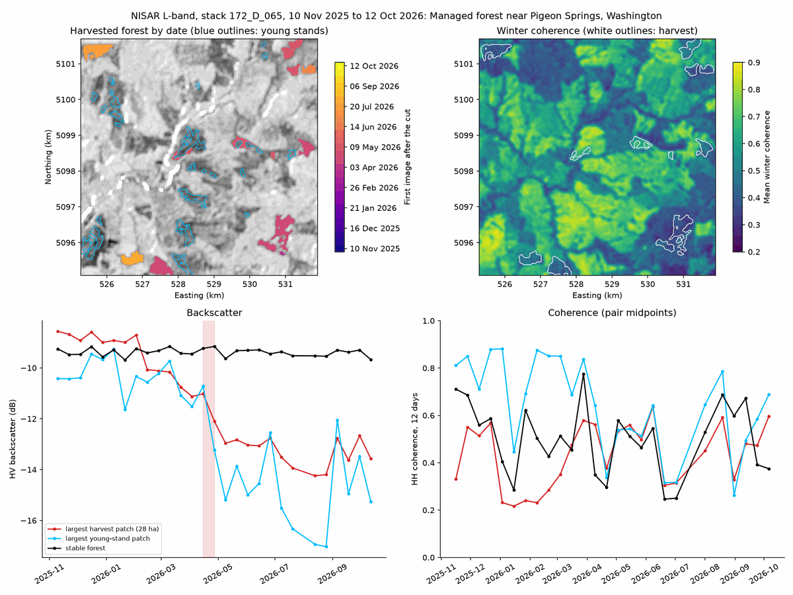

# Forest change from NISAR radar backscatter and coherence

| | |
| --- | --- |
| **Notebook** | [`nisar-backscatter-python.ipynb`](nisar-backscatter-python.ipynb) |
| **Question** | Where and when was forest cut near Pigeon Springs, Washington, during NISAR's first year of calibrated data, and how can radar tell a harvest from a seasonal change? |
| **You will** | Find NISAR GCOV and GUNW granules with `earthaccess` and read their names (maturity, track, direction, frame); read a 6.6 km window from 7 GB HDF5 files over HTTPS with `h5py`, without downloading them; map HH, HV, and a color composite in dB; build a year-long backscatter series on one stack, flag forest patches whose HV dropped, and date each change; use 12-day interferometric coherence to separate harvested forest from young stands |
| **Prerequisites** | [Getting started](../getting-started/); an Earthdata Login in `~/.netrc`. No packages beyond the project environment. |
| **Data** | NISAR L2 GCOV and GUNW, provisional release (track 172, descending, frame 65): 28 GCOV and 26 GUNW granules (about 245 GB in full), plus one beta GCOV granule. The lesson moves about 0.7 GB over the network on its first run and caches about 40 MB. |
| **Time** | About 60 minutes of learner time in three parts, plus about 8 minutes of data reading on the first run |
| **Outputs** | `outputs/nisar-backscatter/python/`: backscatter map (COG, 10 m), change map with HV change, winter coherence, harvest patches, and change dates (COG, 20 m), backscatter and coherence time series and a patch table (CSV), figure (PNG), provenance (JSON) |
| **Level** | Intermediate |

This lesson introduces imaging radar through NASA's NISAR mission. Part A reads one GCOV image and explains backscatter, polarization, decibels, speckle, and terrain correction. Part B reads the same window from every date of one stack, a year of images 12 days apart, and flags forest whose HV backscatter dropped. Backscatter alone flags two kinds of places: stands that were clearcut, and young stands whose backscatter falls every dry season. Part C reads 12-day coherence from the GUNW products and uses winter coherence, which is low over tall forest, to separate the two.

The lesson reads only the chunks of each HDF5 file that overlap the study box. `h5py` opens each file through `earthaccess`'s authenticated HTTPS session (an `fsspec` file with 1 MB blocks), so no subsetting service or whole-file download is involved. Each window is cached as a small GeoTIFF, and later runs, including offline runs, use the cache.

## Study site

The lesson uses a third study site, `cowlitz`, added to [`examples/sites.geojson`](../../examples/sites.geojson) for it: a 6.6 km box of managed conifer forest near Pigeon Springs, Cowlitz County, Washington (tile T10TES). Neither shared site lost forest during NISAR's first year. Wind River's old-growth backscatter is nearly flat all year, and Pando's provisional record starts only in June 2026. The `cowlitz` box lies on the same NISAR stack as Wind River, about 50 km to the west, so the notebook's first exercise switches to Wind River by changing only the site settings.

We chose the box on 2026-11-04 by reading NISAR's 80 m frequency B layer for all 28 dates over about 95 by 90 km around Wind River. That screen found about 150 forest patches with a step drop in HV. The chosen box held the most strong drops, and they matched NDVI losses between Sentinel-2 images from September 2025 and September 2026 (see the checks below).

## Products and references

| Product | Version | Access route | Documentation |
| --- | --- | --- | --- |
| NISAR L2 Geocoded Polarimetric Covariance (GCOV), provisional | `NISAR_L2_GCOV_PROVISIONAL_V1` (`C2854338529-ASF`), product version 1.0.11 | `earthaccess` search; `h5py` over HTTPS (`earthaccess.get_fsspec_https_session()`) | [doi:10.5067/NIL2GCOV-P1](https://doi.org/10.5067/NIL2GCOV-P1); [ASF NISAR documentation](https://nisar-docs.asf.alaska.edu/) |
| NISAR L2 Geocoded Unwrapped Interferogram (GUNW), provisional | `NISAR_L2_GUNW_PROVISIONAL_V1` (`C2854335566-ASF`) | as above | [doi:10.5067/NIL2GUNW-P1](https://doi.org/10.5067/NIL2GUNW-P1) |
| NISAR L2 GCOV, beta (one granule, for comparison) | `NISAR_L2_GCOV_BETA_V1` (`C3622214170-ASF`) | as above | [ASF NISAR documentation](https://nisar-docs.asf.alaska.edu/) |

**Findings while building the lesson** (checked 2026-11-04):

- **NISAR products are at ASF, not LP DAAC.** HTTPS links have the form `https://nisar.asf.earthdatacloud.nasa.gov/NISAR/<collection>/<granule>/<granule>.h5`. A GCOV granule is 6.5 to 7.2 GB and a GUNW granule about 2.3 GB.
- **Remote windows are practical.** GCOV layers are stored in 512 by 512 chunks with gzip compression. Reading HH, HV, and the mask for the box takes about 10 s and moves about 15 MB, much of it the coordinate arrays and the file's index, because each request returns a whole 1 MB block. Blocks of 256 KB moved 11 MB but took about twice as long, because each request has its own delay. The 10 m map date (five layers) moves about 24 MB, and a GUNW coherence window about 9 MB.
- **Beta and provisional releases differ.** The 2026-01-09 acquisition exists in both releases; over the box, the beta HV median is 1.44 dB lower than the provisional one. The lesson uses provisional products only.
- **Masks.** The GCOV `mask` is 0 for pixels made from partly invalid radar samples, 255 outside the swath, and otherwise the subswath number. The GUNW `mask` is a 32-bit integer: bits 0 to 7 hold three decimal digits (water flag, reference subswath, secondary subswath; a 0 subswath digit means invalid), bits 8 to 15 and 16 to 23 hold anomaly flags for the secondary and reference images. The two pairs that include 2026-04-15 carry an anomaly flag; the lesson keeps them and marks them in its coherence plot.
- **Grids line up.** GCOV (10 m) and GUNW (20 m) pixel edges fall on multiples of 20 m in the same UTM zone, so 2 by 2 averages of GCOV match the GUNW grid exactly when the window starts on a 20 m edge. The notebook checks this for every file.
- **One GUNW pair is missing from `earthaccess` searches.** For the `cowlitz` box, CMR's UMM-JSON search (which `earthaccess` uses) reported 72 GUNW hits but returned 69 records; CMR's JSON search returned all 72. The pair 2026-07-08 to 2026-07-20 on track 172 is one of the three, so the lesson has 26 pairs instead of 27. GCOV searches were complete.
- **Search filters.** Granule names give the polarization code: `DH` means HH and HV, `SH` HH only. The lesson keeps one granule per date: the full frame and the highest product counter where NASA reprocessed a date.

## Support status

| Language | Local (Linux/WSL) | CHPC OnDemand, compute node | CHPC transfer job | Colab |
| --- | --- | --- | --- | --- |
| Python | untested | untested | untested (optional) | untested |

## Validation record

| Date | Platform | Language | Run | Result | Runtime | Peak kernel memory | New data cached | Harvest patches |
| --- | --- | --- | --- | --- | --- | --- | --- | --- |

**Checks of the result** (2026-11-04, local; [`validation/`](validation/)):

Full records, with the commit and package versions, are in [`validation/`](validation/). Records of CHPC and Colab runs come from the printed output of `scripts/validate_notebook.py` without `--record`. The environment is described by [`environments/python-base.linux-64.lock.txt`](../../environments/python-base.linux-64.lock.txt).
