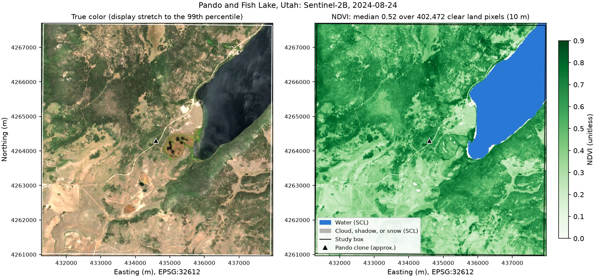

# Seeing Pando at 10 m with Sentinel-2 and STAC

| | |
| --- | --- |
| **Notebooks** | [`sentinel2-stac-python.ipynb`](sentinel2-stac-python.ipynb) · [`sentinel2-stac-r.ipynb`](sentinel2-stac-r.ipynb) |
| **Question** | What does the forest around the Pando aspen stand look like at Sentinel-2's 10 m resolution, in true color and in vegetation greenness? |
| **You will** | Search a STAC catalog and explain collections, items, and assets; check who can read the files; read study-area windows from public cloud storage with the catalog's scale and offset; mask clouds with the scene classification, resampling it with nearest neighbor; make a true-color image and an NDVI map at 10 m |
| **Prerequisites** | [Getting started](../getting-started/). No account is needed. The Python environment must include `pystac-client` (added on 2026-11-04; see below). |
| **Data** | Sentinel-2 Level-2A, Collection 1, from Earth Search; about 3 MB of study-area windows from 5 scenes |
| **Time** | About 20 minutes of learner time; the first run reads data for well under a minute |
| **Outputs** | `outputs/sentinel2-stac/<language>/`: NDVI Cloud Optimized GeoTIFF (10 m), figure (PNG), summary and scene ranking (CSV), provenance with the source STAC item (JSON) |
| **Level** | Beginner |

The lesson introduces STAC, the catalog standard most cloud imagery providers now use, through one provider that needs no account. It follows the [HLS lesson](../hls-vegetation-map/)'s pattern (check the study area before reading, read only small windows into a cache that also works offline, apply documented scaling and quality rules, save with provenance) and adds two ideas: scale and offset recorded in the catalog rather than assumed, and resampling a categorical layer with nearest neighbor.

**Environments created before 2026-11-04** lack `pystac-client`. Add it with `mamba install -p <prefix>/tfs-python -c conda-forge pystac-client` (on CHPC, after `module load miniforge3`), or recreate the environment from [`environments/python-base.yml`](../../environments/python-base.yml).

## Products and references

| Product | Collection | Access route | Documentation |
| --- | --- | --- | --- |
| Sentinel-2 MSI Level-2A surface reflectance | `sentinel-2-c1-l2a` (Collection 1) on [Earth Search](https://earth-search.aws.element84.com/v1) | Python: `pystac-client` search and rasterio windowed reads. R: `rstac` search and GDAL `translate` windows. Both over public HTTPS (no login, no requester-pays charge) | [doi:10.5270/S2_-znk9xsj](https://doi.org/10.5270/S2_-znk9xsj); [Sentinel-2 processing](https://sentiwiki.copernicus.eu/web/s2-processing) |

The default settings use the `pando` site from [`examples/sites.geojson`](../../examples/sites.geojson) (tile 12SVH) and 15 July to 15 September 2024, with scenes under 20% cloud. With these settings the catalog returns 5 scenes. Four are effectively 100% clear in the study box, and the ranking selects `S2B_T12SVH_20240824T181540_L2A` (24 August 2024), the one closest to the middle of the window.

**Two catalog details to know.** Earth Search's older collection, `sentinel-2-l2a`, lists a −0.1 offset in its `raster:bands` metadata although its files for these dates already have the offset removed (they are flagged `earthsearch:boa_offset_applied`), so applying the catalog's offset there gives negative reflectance. Collection 1 is consistent: its catalog metadata and its files both give scale 0.0001 and offset −0.1. Separately, the Collection 1 record's citation link points to ESA's Level-1C DOI; the lesson cites the Level-2A DOI above.

## Support status

| Language | Local (Linux/WSL) | CHPC OnDemand, compute node | CHPC transfer job | Colab |
| --- | --- | --- | --- | --- |
| Python | tested 2026-11-04 | tested 2026-11-04 | untested (optional) | tested 2026-11-04 |
| R | tested 2026-11-04 | untested | untested (optional) | not supported yet |

## Validation record

| Date | Platform | Language | Run | Result | Runtime | Peak kernel memory | New data cached | Files read / cached |
| --- | --- | --- | --- | --- | --- | --- | --- | --- |
| 2026-11-04 | Local (WSL, Ubuntu 22.04) | Python 3.12.16 | Cold (empty cache) | Passed | 13 s | 382 MB | 2.76 MB | 9 / 0 |
| 2026-11-04 | Local (WSL, Ubuntu 22.04) | Python 3.12.16 | Warm (cache) | Passed | 9 s | 372 MB | 0.00 MB | 0 / 9 |
| 2026-11-04 | Local (WSL, Ubuntu 22.04) | Python 3.12.16 | Offline (`TFS_OFFLINE=1`) | Passed | 9 s | 372 MB | 0.00 MB | 0 / 9 |
| 2026-11-04 | CHPC OnDemand, compute node (`notchpeak-shared-short`) | Python 3.12.16 | Cold (empty cache) | Passed | 15 s | 360 MB | 2.76 MB | 9 / 0 |
| 2026-11-04 | Colab (fresh session) | Python 3.13.18 | Cold (empty cache) | Passed | 13 s, excluding package installation | not recorded | not recorded | 9 / 0 |
| 2026-11-04 | Local (WSL, Ubuntu 22.04) | R 4.5.3 | Cold (empty cache) | Passed | 14 s | 502 MB | 2.75 MB | 9 / 0 |
| 2026-11-04 | Local (WSL, Ubuntu 22.04) | R 4.5.3 | Warm (cache) | Passed | 10 s | 498 MB | 0.00 MB | 0 / 9 |
| 2026-11-04 | Local (WSL, Ubuntu 22.04) | R 4.5.3 | Offline (`TFS_OFFLINE=1`) | Passed | 11 s | 487 MB | 0.00 MB | 0 / 9 |
| 2026-11-04 | Local (WSL, Ubuntu 22.04) | R 4.5.3 | Cache from the Python run | Passed | 10 s | 494 MB | 0.09 MB | 0 / 9 |

**Checks of the result** (2026-11-04, local):

- **Known pixels.** For six pixels, NDVI computed by hand from the raw stored values in the full remote files, with ESA's documented scale and offset, matched the lesson's output to within 2.4e-08. For example, a forest pixel stored red 1301 and near-infrared 3685, giving reflectances 0.0301 and 0.2685 and NDVI 0.798.
- **NASA's HLS vegetation index for the same acquisition.** Averaged onto the HLS 30 m grid, the lesson's NDVI agrees with HLS-VI.S30.T12SVH.2024237T180919.v2.0.NDVI.tif with a correlation of 0.978 over 49,761 pixels; the mean difference (Sentinel-2 minus HLS) is -0.028 and 95% of pixels differ by less than 0.1239. HLS processes the same overpass with a different atmospheric correction, a BRDF adjustment, and the narrow near-infrared band, so close agreement rather than identity is expected.
- **Python and R agree exactly.** Both considered the same 5 scenes, selected the same one, and wrote NDVI on the same grid with identical valid-pixel masks (451,570 pixels) and a maximum difference of 0.0. The independent checks give the same results for the R output.
- **Windowed reads.** The selected scene's four 10 m band files and its SCL total about 900 MB; the lesson reads windows of about 2.8 MB in all, from five scenes.
- **Failure messages.** Offline with an empty cache, a date window before Sentinel-2's record, and a cloudy day with the catalog filter turned off each stop with a message that says what to do.

Local Python runs were recorded at commit `580ac0e`, local R runs at `3a1d403`, and the CHPC and Colab runs at `06d25f8`. All selected the same scene and gave identical NDVI statistics.

Full records are in [`validation/`](validation/). Environment: [`python-base.linux-64.lock.txt`](../../environments/python-base.linux-64.lock.txt).
